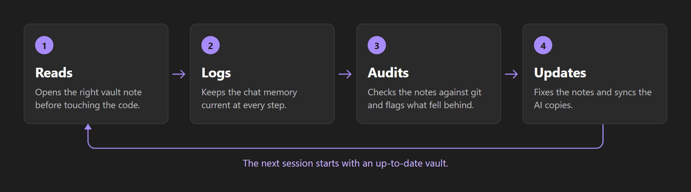
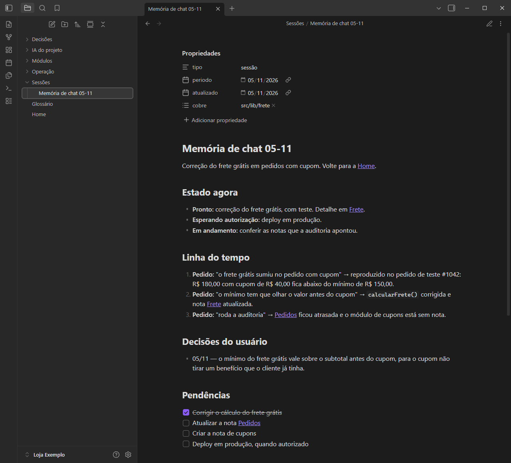
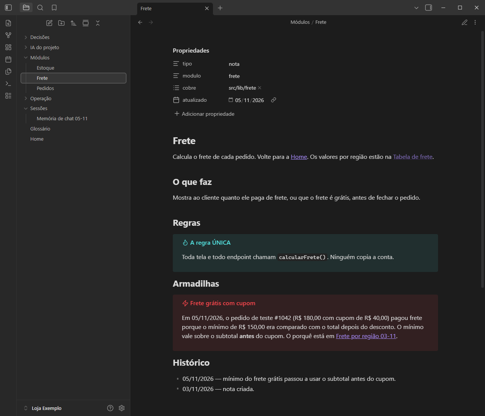
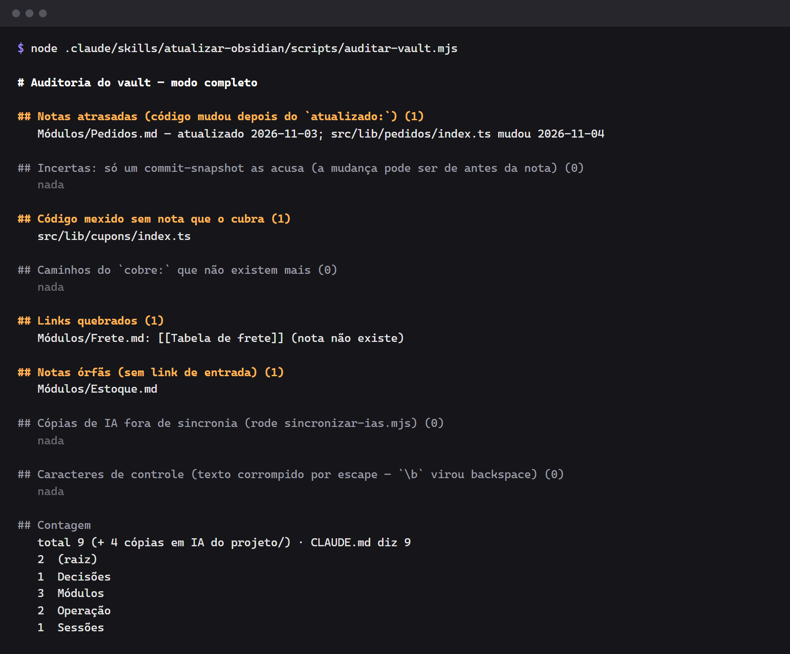
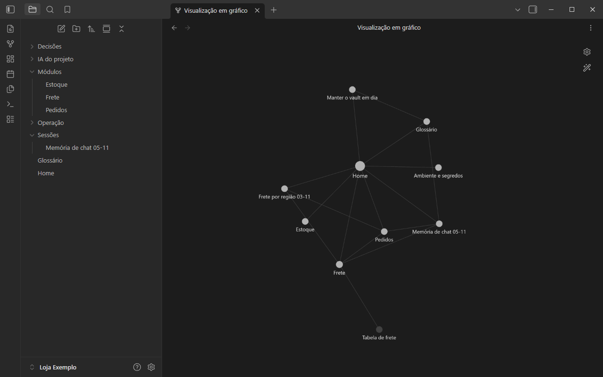

# `atualizar-obsidian` skill — project template

[Português](README.md) · **English** · [Español](README.es.md)

A ready-made template that makes **Claude Code** (and **Codex**) use an **Obsidian** vault as your
project's memory: the AI **reads** the notes before touching the code, **logs** every conversation
in a living memory and **updates** the notes when it finishes, with an audit that flags stale notes,
broken links and undocumented code.

> **Language note:** the skill, the note templates and the script output are written in Portuguese,
> so the examples below are too.

## How it works



## Examples

The images come from "Loja Exemplo", a fictional online store built from this template. The screens
are from Obsidian, and the audit is the script's real output.

### Chat memory

Each conversation gets a note with the current status, a timeline, the decisions and the open items.



### Module note

Each area of the code has a note with its rules and pitfalls. The `cobre:` field says which paths it
documents.



### Audit

In this example, it found one stale note, one code file with no note, one broken link and one orphan
note.



### Vault graph

The notes are linked in Obsidian's graph view, shown here without the `IA do projeto` folder. The
dimmed node, "Tabela de frete", is the broken link the audit flagged.



## What's in the template

```
.
├── CLAUDE.md                          # short instructions: rules + routing table
├── obsidian-skill.config.json         # where the vault is and what counts as code
├── .claude/skills/atualizar-obsidian/
│   ├── SKILL.md                       # the skill (the "manual" the AI follows)
│   └── scripts/
│       ├── config.mjs                 # reads the configuration
│       ├── auditar-vault.mjs          # audits the vault against the code (read-only)
│       └── sincronizar-ias.mjs        # copies CLAUDE.md, skills and memories into the vault
└── Obsidian/Meu Projeto/              # starter vault with note templates
    ├── Home.md, Glossário.md
    ├── Módulos/Modelo - Módulo.md
    ├── Decisões/Modelo - Decisão.md
    ├── Sessões/Modelo - Memória de chat.md
    └── Operação/Manter o vault em dia.md, Ambiente e segredos.md
```

This README, its translations and `docs/images/` only explain the template, so you can delete them
in your project.

## How to use it in your project

1. Click **"Use this template"** (or copy the folders) into the root of your repository.
2. Rename `Obsidian/Meu Projeto` to your project's name and adjust `vault` in
   `obsidian-skill.config.json`.
3. Adjust `codigo` (a regex for the files that **need** a note) and `historicoDesde`.
4. Fill in `CLAUDE.md`: one line in the routing table for each area of the code.
5. Open the vault folder in Obsidian ("Open folder as vault").
6. Run the first audit and the first sync (requires **Node 18+** and **git**):

```bash
node .claude/skills/atualizar-obsidian/scripts/auditar-vault.mjs
node .claude/skills/atualizar-obsidian/scripts/sincronizar-ias.mjs
```

From then on, Claude Code loads the skill on its own whenever a task touches the system.

## Configuration (`obsidian-skill.config.json`)

| Field | Default | What it's for |
| --- | --- | --- |
| `vault` | `Obsidian/Meu Projeto` | vault folder, relative to the root |
| `codigo` | `^(src/\|scripts/\|drizzle/…)` | regex: changed files that need a note |
| `historicoDesde` | `2026-01-01` | how far back the audit reads `git log` |
| `arquivosSnapshot` | `300` | a commit with more files than this is treated as a "snapshot" (uncertain date) |
| `pastaIA` | `IA do projeto` | vault folder with the generated copies |
| `skillsProprias` | `["atualizar-obsidian"]` | skills written for the project (copied in full) |
| `espelharNoCodex` | `["atualizar-obsidian"]` | skills copied to `.agents/skills` |
| `gerarAgentsMd` | `true` | regenerate `AGENTS.md` (Codex) from `CLAUDE.md` |
| `arquivoEnv` | `.env.local` | sensitive values from this file are removed from the copies |

## The audit

```bash
node .claude/skills/atualizar-obsidian/scripts/auditar-vault.mjs --mudados   # only what the working tree changed
node .claude/skills/atualizar-obsidian/scripts/auditar-vault.mjs --detalhe   # + the commits that made each note stale
node .claude/skills/atualizar-obsidian/scripts/auditar-vault.mjs --json      # output for another tool
```

It compares each note's `cobre:` and `atualizado:` frontmatter with the git history and lists: stale
notes, code with no note, paths that no longer exist, broken `[[...]]` and `[[...#section]]` links,
orphan notes, out-of-sync copies, control characters and the note count against the number declared
in `CLAUDE.md`. See real output under [Examples](#examples).

## Security

- `sincronizar-ias.mjs` replaces known tokens (GitHub, OpenAI, JWT, Supabase) **and** every sensitive
  variable value from `.env.local` with `[segredo removido]`.
- Even so, don't write secrets or customers' personal data in the notes.

## License

MIT.
