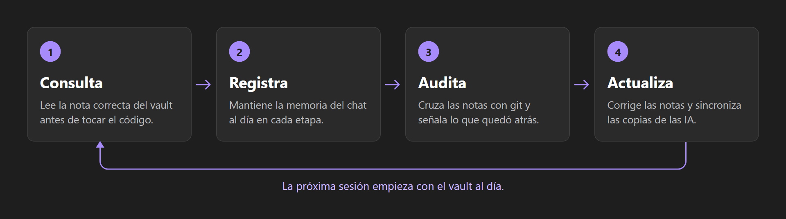
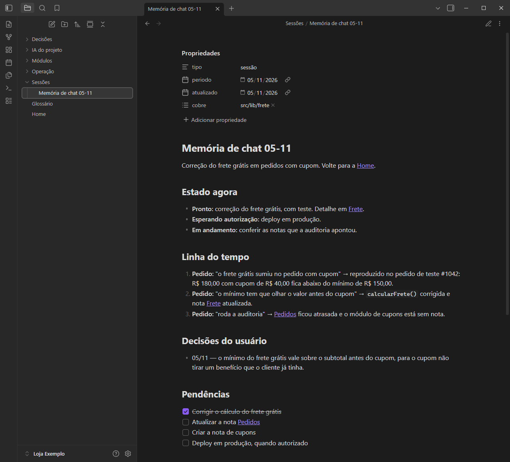
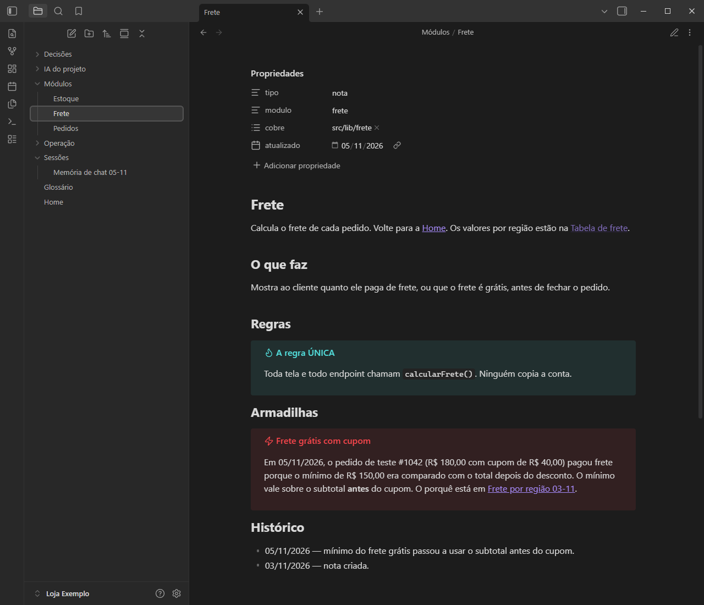
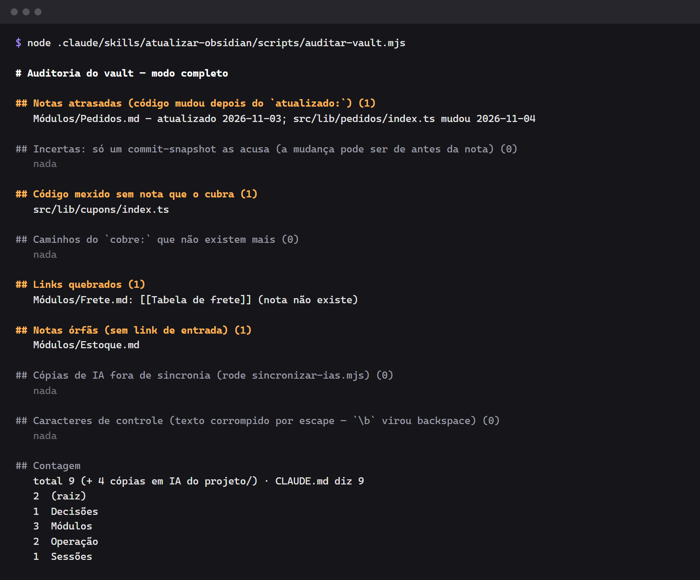
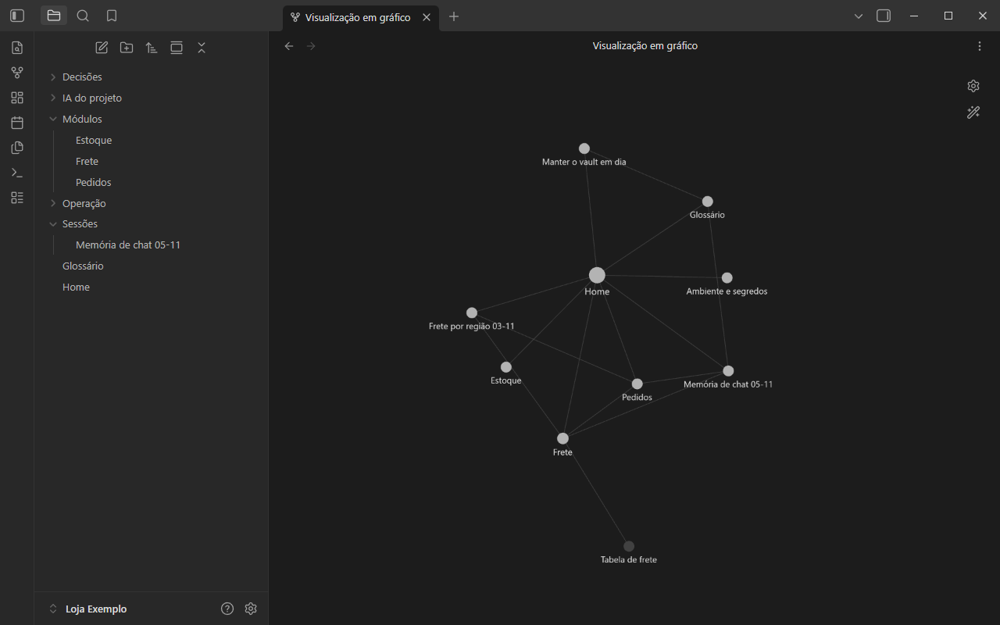

# Skill `atualizar-obsidian`: plantilla de proyecto

[Português](README.md) · [English](README.en.md) · **Español**

Una plantilla lista para que **Claude Code** (y **Codex**) usen un vault de **Obsidian** como la
memoria de tu proyecto: la IA **consulta** las notas antes de tocar el código, **registra** cada
conversación en una memoria viva y **actualiza** las notas al terminar, con una auditoría que señala
notas atrasadas, enlaces rotos y código sin documentar.

> **Nota sobre el idioma:** la skill, las plantillas de notas y la salida de los scripts están en
> portugués, y por eso los ejemplos de abajo también.

## Cómo funciona



## Ejemplos

Las imágenes vienen de "Loja Exemplo", una tienda en línea ficticia creada a partir de esta
plantilla. Las pantallas son de Obsidian, y la auditoría es la salida real del script.

### Memoria del chat

Cada conversación tiene una nota con el estado actual, la línea de tiempo, las decisiones y los
pendientes.



### Nota de módulo

Cada área del código tiene una nota con sus reglas y trampas. El campo `cobre:` indica qué rutas
documenta.



### Auditoría

En este ejemplo, encontró una nota atrasada, un archivo de código sin nota, un enlace roto y una nota
huérfana.



### Grafo del vault

Las notas están enlazadas en el grafo de Obsidian, que aquí se muestra sin la carpeta
`IA do projeto`. El nodo atenuado, "Tabela de frete", es el enlace roto que señaló la auditoría.



## Qué incluye la plantilla

```
.
├── CLAUDE.md                          # instrucciones breves: reglas + tabla de enrutamiento
├── obsidian-skill.config.json         # dónde está el vault y qué cuenta como código
├── .claude/skills/atualizar-obsidian/
│   ├── SKILL.md                       # la skill (el "manual" que sigue la IA)
│   └── scripts/
│       ├── config.mjs                 # lee la configuración
│       ├── auditar-vault.mjs          # audita el vault contra el código (solo lectura)
│       └── sincronizar-ias.mjs        # copia CLAUDE.md, skills y memorias al vault
└── Obsidian/Meu Projeto/              # vault inicial con plantillas de notas
    ├── Home.md, Glossário.md
    ├── Módulos/Modelo - Módulo.md
    ├── Decisões/Modelo - Decisão.md
    ├── Sessões/Modelo - Memória de chat.md
    └── Operação/Manter o vault em dia.md, Ambiente e segredos.md
```

Este README, sus traducciones y `docs/images/` solo explican la plantilla, así que puedes borrarlos
en tu proyecto.

## Cómo usarla en tu proyecto

1. Haz clic en **"Use this template"** (o copia las carpetas) en la raíz de tu repositorio.
2. Cambia el nombre de `Obsidian/Meu Projeto` por el de tu proyecto y ajusta `vault` en
   `obsidian-skill.config.json`.
3. Ajusta `codigo` (regex de los archivos que **necesitan** una nota) e `historicoDesde`.
4. Completa `CLAUDE.md`: una línea en la tabla de enrutamiento por cada área del código.
5. Abre la carpeta del vault en Obsidian ("Open folder as vault").
6. Ejecuta la primera auditoría y la primera sincronización (requiere **Node 18+** y **git**):

```bash
node .claude/skills/atualizar-obsidian/scripts/auditar-vault.mjs
node .claude/skills/atualizar-obsidian/scripts/sincronizar-ias.mjs
```

A partir de ahí, Claude Code carga la skill por sí solo cada vez que una tarea toca el sistema.

## Configuración (`obsidian-skill.config.json`)

| Campo | Valor por defecto | Para qué sirve |
| --- | --- | --- |
| `vault` | `Obsidian/Meu Projeto` | carpeta del vault, relativa a la raíz |
| `codigo` | `^(src/\|scripts/\|drizzle/…)` | regex: archivos modificados que necesitan una nota |
| `historicoDesde` | `2026-01-01` | hasta dónde mira la auditoría en el `git log` |
| `arquivosSnapshot` | `300` | un commit con más archivos que este valor se trata como "snapshot" (fecha incierta) |
| `pastaIA` | `IA do projeto` | carpeta del vault con las copias generadas |
| `skillsProprias` | `["atualizar-obsidian"]` | skills escritas para el proyecto (se copian enteras) |
| `espelharNoCodex` | `["atualizar-obsidian"]` | skills copiadas a `.agents/skills` |
| `gerarAgentsMd` | `true` | regenerar `AGENTS.md` (Codex) a partir de `CLAUDE.md` |
| `arquivoEnv` | `.env.local` | los valores sensibles de este archivo se eliminan de las copias |

## La auditoría

```bash
node .claude/skills/atualizar-obsidian/scripts/auditar-vault.mjs --mudados   # solo lo que cambió en el working tree
node .claude/skills/atualizar-obsidian/scripts/auditar-vault.mjs --detalhe   # + los commits que atrasaron cada nota
node .claude/skills/atualizar-obsidian/scripts/auditar-vault.mjs --json      # salida para otra herramienta
```

Compara el `cobre:` y el `atualizado:` del frontmatter de cada nota con el historial de git y lista:
notas atrasadas, código sin nota, rutas que ya no existen, enlaces `[[...]]` y `[[...#sección]]`
rotos, notas huérfanas, copias desincronizadas, caracteres de control y el recuento de notas frente
al número declarado en `CLAUDE.md`. Puedes ver una salida real en [Ejemplos](#ejemplos).

## Seguridad

- `sincronizar-ias.mjs` reemplaza por `[segredo removido]` los tokens conocidos (GitHub, OpenAI, JWT,
  Supabase) **y** todos los valores de variables sensibles de `.env.local`.
- Aun así, no escribas secretos ni datos personales de clientes en las notas.

## Licencia

MIT.
