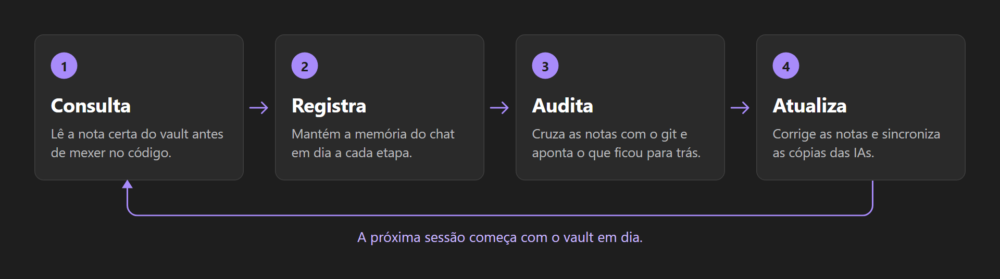
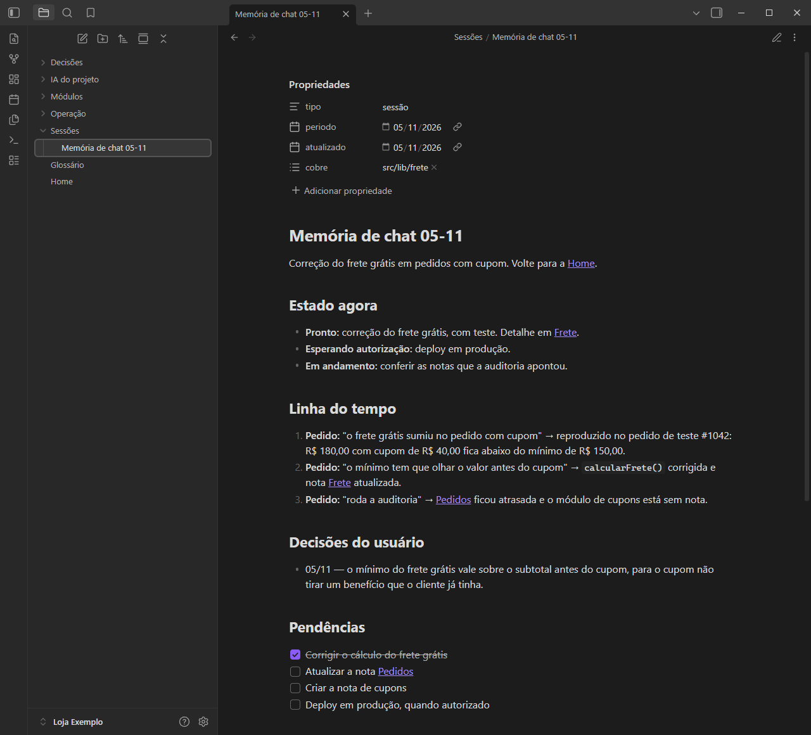
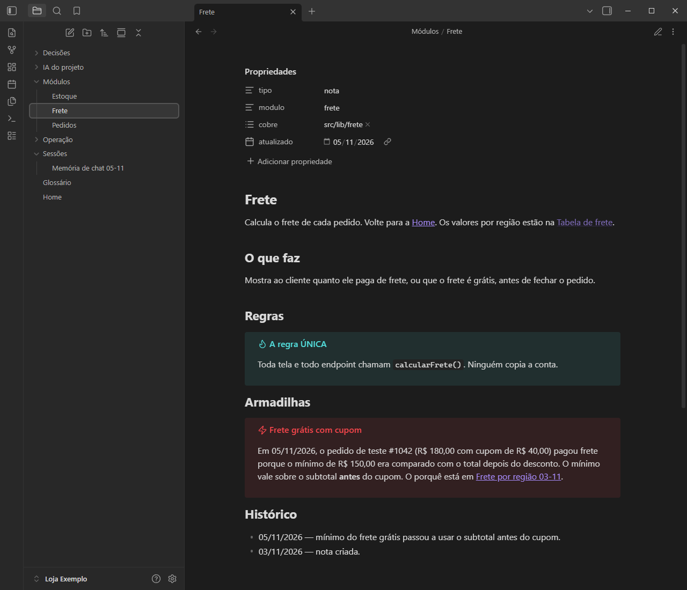
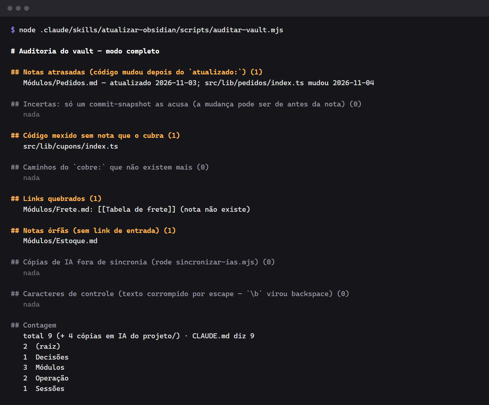
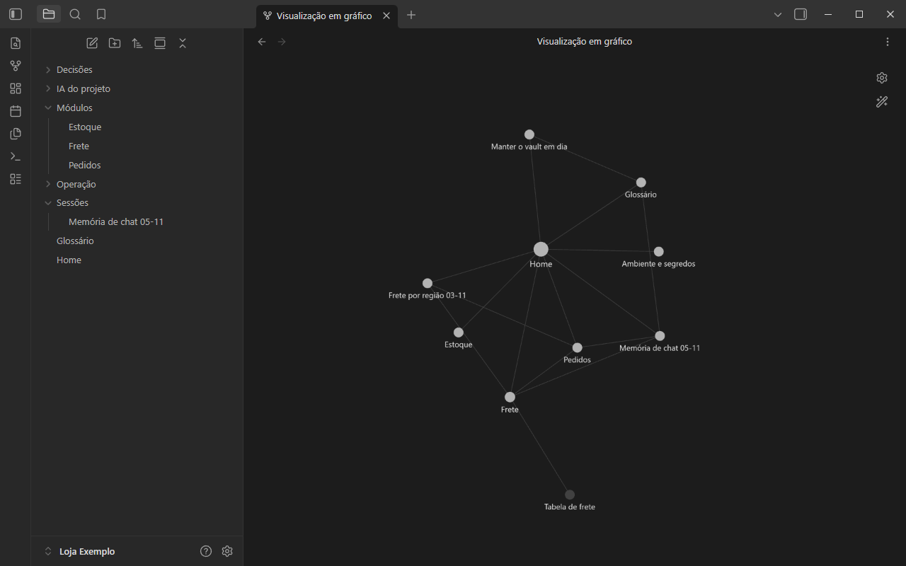

# Skill `atualizar-obsidian` — modelo de projeto

**Português** · [English](README.en.md) · [Español](README.es.md)

Modelo pronto para fazer o **Claude Code** (e o **Codex**) usar um vault do **Obsidian** como a
memória do seu projeto: a IA **consulta** as notas antes de mexer no código, **registra** cada
conversa numa memória viva e **atualiza** as notas ao terminar — com uma auditoria que aponta
nota atrasada, link quebrado e código sem documentação.

## Como funciona



## Exemplos

As imagens vêm da "Loja Exemplo", um projeto fictício criado a partir deste modelo. As telas são do
Obsidian, e a auditoria é a saída real do script.

### Memória de chat

Cada conversa ganha uma nota com o estado atual, a linha do tempo, as decisões e as pendências.



### Nota de módulo

Cada área do código tem uma nota com as regras e as armadilhas. O campo `cobre:` diz quais caminhos
ela documenta.



### Auditoria

Neste exemplo, ela encontrou uma nota atrasada, um código sem nota, um link quebrado e uma nota órfã.



### Grafo do vault

As notas ficam ligadas no grafo do Obsidian, aqui sem a pasta `IA do projeto`. O nó apagado,
"Tabela de frete", é o link quebrado que a auditoria apontou.



## O que vem no modelo

```
.
├── CLAUDE.md                          # instruções curtas: regras + tabela de roteamento
├── obsidian-skill.config.json         # onde está o vault e o que conta como código
├── .claude/skills/atualizar-obsidian/
│   ├── SKILL.md                       # a skill (o "manual" que a IA segue)
│   └── scripts/
│       ├── config.mjs                 # lê a configuração
│       ├── auditar-vault.mjs          # auditoria do vault contra o código (só lê)
│       └── sincronizar-ias.mjs        # copia CLAUDE.md, skills e memórias para o vault
└── Obsidian/Meu Projeto/              # vault inicial com modelos de nota
    ├── Home.md, Glossário.md
    ├── Módulos/Modelo - Módulo.md
    ├── Decisões/Modelo - Decisão.md
    ├── Sessões/Modelo - Memória de chat.md
    └── Operação/Manter o vault em dia.md, Ambiente e segredos.md
```

Este README, as traduções e `docs/images/` só explicam o modelo: pode apagar tudo isso no seu projeto.

## Como usar no seu projeto

1. Clique em **"Use this template"** (ou copie as pastas) para a raiz do seu repositório.
2. Renomeie `Obsidian/Meu Projeto` para o nome do seu projeto e ajuste `vault` em
   `obsidian-skill.config.json`.
3. Ajuste `codigo` (regex dos arquivos que **precisam** de nota) e `historicoDesde`.
4. Preencha o `CLAUDE.md`: uma linha na tabela de roteamento para cada área do código.
5. Abra a pasta do vault no Obsidian ("Open folder as vault").
6. Rode a primeira auditoria e a primeira sincronia (precisa de **Node 18+** e **git**):

```bash
node .claude/skills/atualizar-obsidian/scripts/auditar-vault.mjs
node .claude/skills/atualizar-obsidian/scripts/sincronizar-ias.mjs
```

A partir daí o Claude Code carrega a skill sozinho sempre que a tarefa mexer no sistema.

## Configuração (`obsidian-skill.config.json`)

| Campo | Padrão | Para quê |
| --- | --- | --- |
| `vault` | `Obsidian/Meu Projeto` | pasta do vault, relativa à raiz |
| `codigo` | `^(src/\|scripts/\|drizzle/…)` | regex: arquivos mexidos que precisam de nota |
| `historicoDesde` | `2026-01-01` | até onde a auditoria olha o `git log` |
| `arquivosSnapshot` | `300` | commit com mais arquivos que isto é tratado como "snapshot" (data incerta) |
| `pastaIA` | `IA do projeto` | pasta do vault com as cópias geradas |
| `skillsProprias` | `["atualizar-obsidian"]` | skills escritas para o projeto (copiadas por inteiro) |
| `espelharNoCodex` | `["atualizar-obsidian"]` | skills copiadas para `.agents/skills` |
| `gerarAgentsMd` | `true` | regenerar o `AGENTS.md` (Codex) a partir do `CLAUDE.md` |
| `arquivoEnv` | `.env.local` | valores sensíveis daqui são apagados das cópias |

## A auditoria

```bash
node .claude/skills/atualizar-obsidian/scripts/auditar-vault.mjs --mudados   # só o que a working tree mexeu
node .claude/skills/atualizar-obsidian/scripts/auditar-vault.mjs --detalhe   # + commits que atrasaram cada nota
node .claude/skills/atualizar-obsidian/scripts/auditar-vault.mjs --json      # saída para outra ferramenta
```

Ela cruza o `cobre:` + `atualizado:` do frontmatter de cada nota com o histórico do git e lista:
notas atrasadas, código sem nota, caminhos que sumiram, links `[[...]]` e `[[...#seção]]`
quebrados, notas órfãs, cópias fora de sincronia, caracteres de controle e a contagem de notas
contra o número declarado no `CLAUDE.md`. Veja uma saída real em [Exemplos](#exemplos).

## Segurança

- O `sincronizar-ias.mjs` troca por `[segredo removido]` tokens conhecidos (GitHub, OpenAI,
  JWT, Supabase) **e** todo valor de variável sensível do `.env.local`.
- Mesmo assim: não escreva segredo nem dado pessoal de cliente nas notas.

## Licença

MIT.
